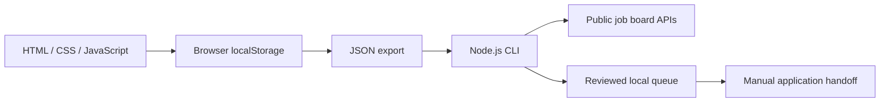

# Dev Master

**A local-first workspace for career development and application tracking.**

[](https://github.com/JessicaSoares/dev-master/actions/workflows/ci.yml)

Personal portfolio prototype developed with AI coding assistance. Built to make the job search easier to organize: save opportunities, assess skills, track applications and prepare application material for review.

## Run in two commands

Requires Node.js 20+. No npm dependencies or API keys needed for the dashboard and tests.

```bash
git clone https://github.com/JessicaSoares/dev-master.git
cd dev-master
npm start
```

Open **http://localhost:3000**. The dashboard is in Brazilian Portuguese. Demo vacancies are fictional and clearly labeled. Profile fields start empty; no real candidate data is bundled.

## What works

- Six dashboard views: overview, profile, self-assessment, learning, vacancies and applications.
- Vacancy registration, filtering and pipeline stages.
- Browser-local persistence and JSON backup export.
- Node.js CLI: public Lever/Greenhouse job discovery by company, URL normalization and deduplication.
- Form inspection, required-field validation and reviewed application queues.
- Assisted preparation for Indeed, InfoJobs and Gupy, with manual submission.

## Architecture and decisions



The dashboard and CLI are separate. Keeping the first version local avoids a database and authentication service, but also means **no cross-device synchronization**. HTTP dependencies are injected into the engine for deterministic tests. Ambiguous submissions are recorded for manual verification rather than blindly retried; queues persist state atomically.

## Verification

```bash
npm run check
node check.cjs
npm run test:bot
```

Tests cover URL validation and deduplication, approval gates, credentials, ambiguous failures, rate limits, recovery, form questions, consent options and manual handoff. The UI smoke check uses a simulated DOM; it is not a browser end-to-end suite. External API tests use simulated HTTP, not real employer submissions.

## Boundaries

This is not a universal auto-apply bot. The dashboard does not submit applications and is not integrated with the CLI. Lever/Greenhouse submission code requires an authorized **employer-side API key**, not a candidate password. No real submission has been validated. Never commit exported profiles, resumes, credentials or queue data; keep local files in `bot/data/`, ignored by Git. See [the connector documentation](bot/README.md).

## Next improvements

- Import and validate backups.
- Browser integration tests and accessible keyboard journeys.
- Integrate discovery and reviewed handoff with the dashboard.
- Add durable storage only when multi-device usage justifies the added complexity.

## Em português

Projeto pessoal para organizar evolução profissional e candidaturas. O painel funciona localmente e guarda os dados no navegador. O motor Node.js consulta fontes públicas por empresa, prepara filas e materiais para revisão, com testes de falhas e validação. Desenvolvido com apoio de IA; é um protótipo de portfólio, sem relação com código de clientes. Os limites acima fazem parte do escopo atual.
